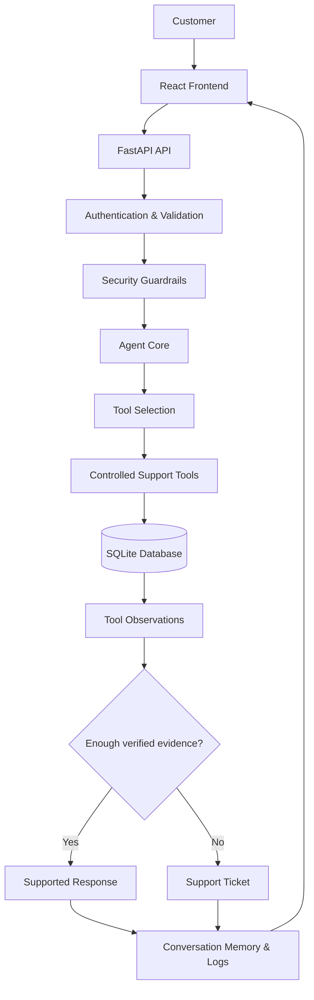

# Customer Connect | ResolveAI

<div align="center">


### A Security-Conscious, Tool-Using AI Customer Support Agent

Investigates customer issues through controlled tool execution, verifies information against backend records, and escalates unresolved cases to human support.

<br/>

<a href="https://github.com/priyanshi17112007/Customer_Connect"></a>
<a href="docs/SECURITY.md"></a>
<a href="docs/PRODUCTION_READINESS.md"></a>


</div>

---

## The idea

Most support chatbots stop at generating an answer. **ResolveAI is designed to investigate before answering.**

It classifies customer requests, selects approved tools, observes actual results, decides whether more investigation is needed, and returns a supported response or creates a support ticket.

Its core principle is simple: **the LLM interprets; the backend verifies.**

## What makes ResolveAI interesting?

<table>
<tr>
<td width="50%" valign="top">

### 🧠 Agentic execution
- Intent classification and entity extraction
- Conditional tool selection
- Multi-step execution and observation
- Bounded execution with controlled decisions

### 📦 Customer support
- Order and delivery investigation
- Payment and refund status
- Return eligibility checks
- Automated ticket escalation

</td>
<td width="50%" valign="top">

### 🛡️ Security engineering
- API-key authentication
- Customer ownership enforcement
- Prompt-injection guardrails
- Rate limiting and request validation
- Structured errors and log redaction

### 🔎 Observability
- Agent activity timeline
- Conversation continuity
- Tool execution records
- Security and operational logging

</td>
</tr>
</table>

## System architecture



**Agent lifecycle:** Understand → Validate → Select → Execute → Observe → Decide → Respond or Escalate.

## Technology stack

<div align="center">

<a href="https://www.python.org/"></a>&nbsp;
<a href="https://fastapi.tiangolo.com/"></a>&nbsp;
<a href="https://react.dev/"></a>&nbsp;
<a href="https://vite.dev/"></a>&nbsp;
<a href="https://www.sqlite.org/"></a>&nbsp;
<a href="https://git-scm.com/"></a>&nbsp;
<a href="https://github.com/"></a>

</div>

| Layer | Technologies |
|---|---|
| Frontend | React, JavaScript, Vite, CSS |
| Backend | Python, FastAPI, Uvicorn, Pydantic |
| Persistence | SQLAlchemy, SQLite |
| AI integration | Optional Gemini/Groq integration |
| Testing | Python `unittest`, API contract and security regression tests |
| Engineering | Git, GitHub, environment-based configuration |

## Engineering highlights

- **Evidence-based responses:** order, delivery, payment, and refund facts come from backend tool results, not invented model output.
- **Controlled actions:** the agent uses an allow-listed set of backend tools rather than arbitrary functions.
- **Customer isolation:** ownership checks prevent a customer from accessing another customer's protected records.
- **Safe escalation:** unresolved support issues can generate tickets instead of receiving unsupported assurances.
- **Failure handling:** validation, authentication, timeouts, tool failures, and structured errors are part of the design.

## Quick start

**Prerequisites:** Python 3.11 or a compatible version, Node.js, npm, and Git.

### 1. Clone and configure

```bash
git clone https://github.com/priyanshi17112007/Customer_Connect.git
cd Customer_Connect
```

Create the Python environment and install dependencies:

```powershell
py -m venv .venv
.\.venv\Scripts\Activate.ps1
python -m pip install -r backend/requirements.txt
Copy-Item backend/.env.example backend/.env
```

Configure `backend/.env` with a unique `APP_API_KEY`. Provider credentials are needed only if an external LLM integration is enabled. Never commit real secrets.

### 2. Run the backend

```powershell
cd backend
python -m uvicorn app.main:app --host 127.0.0.1 --port 8000
```

Health endpoint: `http://127.0.0.1:8000/health`

### 3. Run the frontend

Open a second terminal:

```powershell
cd frontend
npm install
npm run dev
```

Open the local URL printed by Vite, usually `http://localhost:5173`.

The website's API Access Key field expects the backend's `APP_API_KEY`, **not** a Gemini or Groq provider key.

## API at a glance

| Method | Endpoint | Purpose |
|---|---|---|
| `GET` | `/health` | Backend health check |
| `POST` | `/api/v1/chat` | Authenticated support conversation |

Example request:

```json
{
  "customer_id": "CUS-001",
  "message": "Where is my order ORD-10234?",
  "conversation_id": null
}
```

Requests use the `X-API-Key` header. The identifiers above are examples from the local seeded dataset, not live merchant records.

## Verification and testing

Run the committed backend tests from the backend directory:

```powershell
python -m unittest discover -s tests -t .
```

Build the frontend:

```powershell
cd ..\frontend
npm run build
```

The project has undergone regression checks covering agent workflows, customer ownership, rate limits, ticket creation, API contracts, and security behavior. Results apply to the tested revision and environment; they are not a guarantee of production security.

## Repository structure

```text
Customer_Connect/
├── backend/
│   ├── app/
│   │   ├── agents/
│   │   ├── api/
│   │   ├── database/
│   │   ├── models/
│   │   ├── security/
│   │   └── tools/
│   ├── tests/
│   ├── .env.example
│   └── requirements.txt
├── frontend/
│   └── src/
│       ├── components/
│       ├── services/
│       └── styles/
├── docs/
│   ├── SECURITY.md
│   └── PRODUCTION_READINESS.md
├── .gitignore
└── README.md
```

## Roadmap

- [x] Bounded tool-using agent workflow
- [x] Order, payment, delivery, refund, and return investigation
- [x] Security guardrails and customer ownership checks
- [x] Conversation memory and support-ticket escalation
- [x] React–FastAPI integration
- [ ] Live e-commerce platform integration
- [ ] Production identity and role-based authorization
- [ ] PostgreSQL and database migrations
- [ ] Deployment automation and production monitoring

## Current scope

ResolveAI currently uses seeded demonstration data; it is **not connected to a live e-commerce platform**. External LLM behavior depends on provider configuration. The application is a portfolio and development project and requires additional infrastructure and identity controls before production use.

Security documentation: [SECURITY.md](docs/SECURITY.md) · [PRODUCTION_READINESS.md](docs/PRODUCTION_READINESS.md)

---

<div align="center">

### Built by Priyanshi Sharma

**AI Development · Agentic Systems · Python · Full-Stack Engineering**

<a href="https://github.com/priyanshi17112007"></a>

<a href="https://github.com/priyanshi17112007/Customer_Connect">View Repository</a>

<br/>

*Engineering AI systems that don't just answer — they investigate.*

</div>

